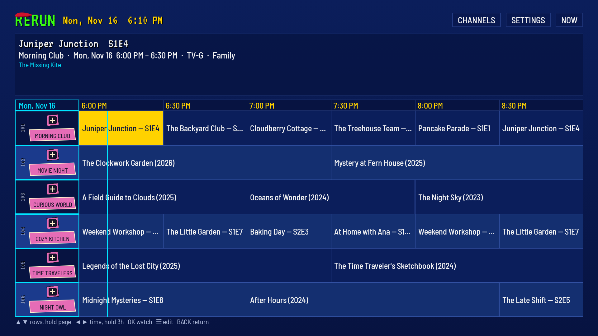

# Rerun

**Old-school TV, powered by your own Plex library.**

Rerun turns the movies, episodes, and music already on **your own Plex server** into a nostalgic, always-on TV experience. Tune in mid-program, flip through a retro guide, and build channels around the media you choose.

> **Your library, not a streaming service.** Rerun is only a frontend. It does not provide media, subscriptions, a Plex server, or access to a shared content library. You bring your own server and media; Rerun plays only the libraries you select.



*The real Rerun guide, rendered with fictional channels and program names. No real library metadata is shown.*

## What it does

- **Feels like channel surfing:** programs follow a device-local schedule, so you join whatever is already playing.
- **Automatic and custom channels:** create a lineup from your selected movie, episode, and music libraries using genres, shows, collections, decades, ratings, languages, and more.
- **Retro presentation:** browse a three-hour guide, pick a color theme, and enable optional CRT and tuning effects.
- **Playback your way:** choose subtitles and audio tracks, start a program over, or save an episode queue for later.
- **Music stations:** listen by genre or decade with album artwork and a moving display designed to reduce static-image burn-in.
- **Series marathons:** Naruto and Shippuden stations play every episode in order, back to back, then repeat; set any custom channel to Marathon and pick its shows with **Find related**.
- **Optional ad breaks:** fill breaks with short clips from your own separate library, or turn ads off per channel.

Browse the [complete built-in channel guide](docs/channels.md) for default numbers, programming descriptions, and generated channel families.

Rerun does not report watch progress or history back to Plex.

## Get started

### What you need

- Your own Plex server and media libraries, reachable from the device running Rerun.
- An Android device running Android 8.0 or newer. TVs use a remote; phones and tablets use touch controls in landscape.
- To build from source: a Windows PC with JDK 17 or newer, Android SDK platform 37, and `adb`.

### Install

#### Phones and tablets

1. Download an APK from the repository's **Releases** page directly onto your device, or copy the APK to it.
2. Open the APK from your browser's downloads or a file manager.
3. If prompted, allow that browser or file manager to **install unknown apps**, then confirm **Install**. No PC or ADB connection is needed.

#### TVs

Download and open an APK with a file manager, or build and install it from a Windows PC over network ADB:

1. On the TV, enable developer options and network ADB debugging, then find its IP address.
2. Run this command from the repository root, replacing the example address:

```powershell
.\scripts\install.ps1 -TvIp 192.168.1.50
```

The first source build creates a private signing key and `keystore.properties`. Back up both files and keep them private; the same key is required for future updates.

### Set up Rerun after installing

Setup runs on the device, except for the one-time account link. Make sure your Plex server is running and reachable before you begin.

1. **Link your Plex account.** Open Rerun and note the code on screen. On a phone or computer, visit **plex.tv/link**, sign in to the account that owns your server, and enter the code. Rerun continues automatically after the link is approved.
2. **Choose your server.** If the account has more than one server, select yours. With only one available server, Rerun selects it automatically and tests the connection. If it cannot connect, check that the server is running and reachable, then choose **Try again**.
3. **Choose whether to use ads.** **Disable ads** is selected initially. Keep that choice, or select a separate **Other Videos** or **Movies** library containing your own commercial clips and choose **Continue**. Rerun syncs this ad catalog before moving on; the selected ad library is kept out of regular program imports.
4. **Select your media libraries.** Initially, all available regular libraries are included. Use OK or tap to deselect anything Rerun should not read. Movie, TV show, and music libraries can be mixed, but at least one library must remain included. Choose **Continue** when ready.
5. **Wait for the first sync.** Rerun reads the selected library metadata, builds your channel lineup, and creates schedules on the device. Progress is shown on screen; a large library can take a while.
6. **Start channel surfing.** Rerun opens playback when setup finishes. Use Up/Down to change channels, or open the guide to browse what is playing.

After setup, use **Settings > Manage libraries** to change library selections or resync, and **Settings > Ad library** to change the ad source. New libraries added to the server are not included automatically. Use **Channels** to customize stations or **Settings > Lineup** to change the minimum programming required for stations to appear.

## Controls

| Input | While watching | In the guide |
|---|---|---|
| Up / Down | Channel up / down | Move between channels |
| Hold Up / Down | — | Page through channels |
| Left | Last channel | Earlier |
| Right or OK | Show information | Later / tune in |
| Hold Left | Start the current program over | Jump three hours earlier |
| Hold Right | Choose this program's audio track | Jump three hours later |
| Menu | Open the guide | Edit the selected channel |
| Back | Open the guide | Return to playback |

Hold OK while watching to cycle the CRT effect. On touch devices, swipe to change channels, tap for controls, and hold to open the guide.

## Privacy and ownership

- Playback comes from the Plex server you connect; Rerun does not host or relay your media.
- Schedules and lineup preferences are generated and stored on your device.
- Rerun never sends scrobble, timeline, or watch-history updates to Plex.
- Use media and optional clips that you own or have the right to watch.

## Development

Build a debug APK from the repository root:

```powershell
. .\scripts\jdk.ps1
Set-RerunJdk
.\gradlew.bat :app:assembleDebug
```

Debug builds do not need release signing. See the [contributor guide](AGENTS.md) for architecture, validation commands, and project conventions.

## License and credits

Rerun is available under the [MIT License](LICENSE).

VT323 and Barlow Semi Condensed are bundled under the SIL Open Font License; see `licenses/`.

Rerun is an independent project and is not affiliated with or endorsed by Plex.
